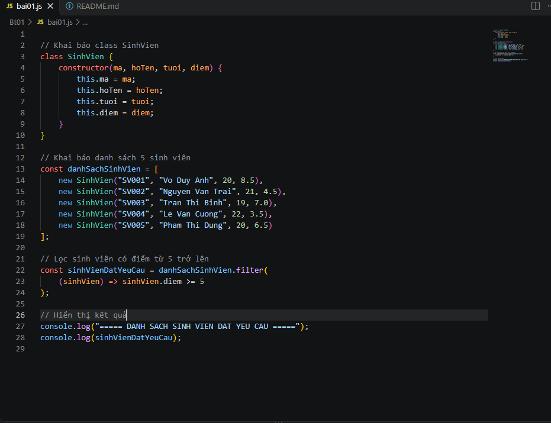
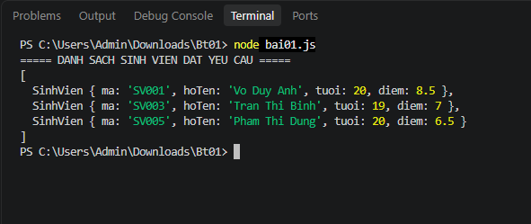

## 1. Cách chạy chương trình

Bước 1: Tạo thư mục bài tập

Mở PowerShell và di chuyển đến thư mục chứa bài tập:

mkdir Bt01
cd Bt01

Bước 2: Tạo tập tin bai01.js

Sử dụng lệnh:

notepad bai01.js

Nhập mã nguồn JavaScript thực hiện các yêu cầu của bài tập và lưu tập tin.

Bước 3: Chạy chương trình

Tại Terminal, thực hiện lệnh:

node bai01.js

Bước 4: Kiểm tra kết quả

Sau khi chạy chương trình, Terminal hiển thị danh sách sinh viên có điểm từ 5 trở lên.

## 2. Kết quả thực hiện

Chương trình chạy thành công và hiển thị 3 sinh viên có điểm từ 5 trở lên:

SV001 – Vo Duy Anh – 20 tuổi – 8.5 điểm.

SV003 – Tran Thi Binh – 19 tuổi – 7.0 điểm.

SV005 – Pham Thi Dung – 20 tuổi – 6.5 điểm.

Hai sinh viên SV002 và SV004 không được hiển thị vì có điểm dưới 5

## 3. Hình ảnh minh chứng

### Ảnh 1: Mã nguồn chương trình

### Ảnh 2: Kết quả thực hiện chương trình

